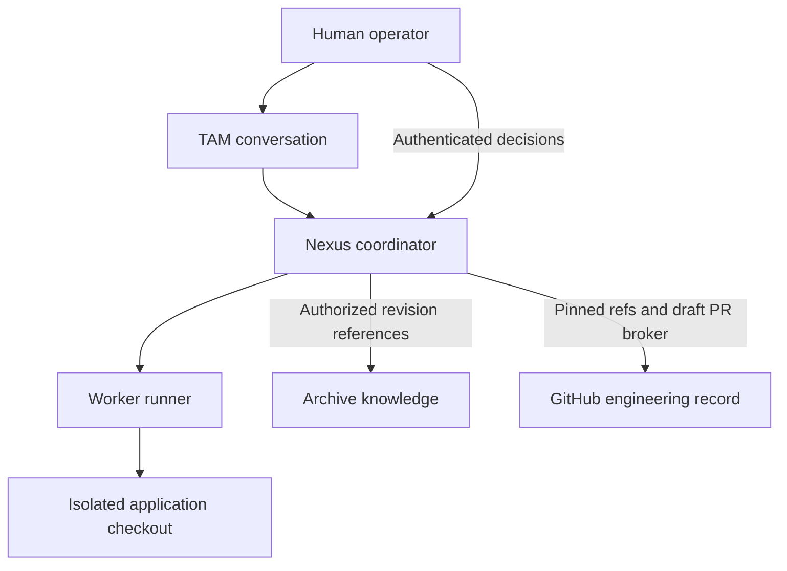
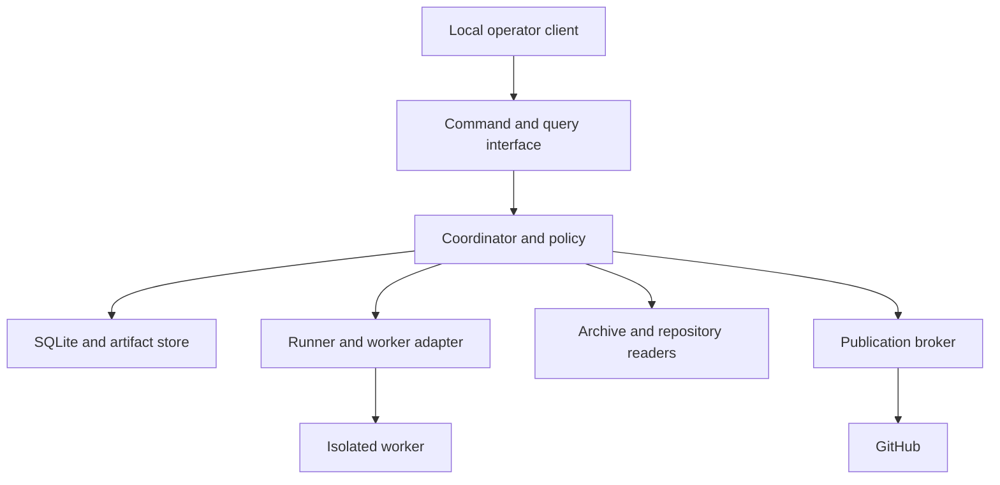

# NX-001 architecture

**Status** Proposed. Single operator and Linux host initially. TAM is the human-facing assistant across conversation, engineering and research. Nexus coordinates work the operator has explicitly requested. The assistant can propose tasks and summarize evidence through the same permission boundary as any other client.

## Responsibilities and state

| Owner | Authoritative state or responsibility |
| --- | --- |
| Human operator | Objectives, priorities, security/data policy, implementation and publication decisions, final acceptance, and control of merge/deployment in the corresponding external system |
| TAM conversational client | Conversation interaction and message source. Nexus keeps immutable references and the minimum authorized source excerpt needed to audit promoted work. Durable transcript storage is a client choice. |
| Nexus | Project/resource registry, work revisions, execution state, local authorization decisions, attempts, event history, context manifests, and controlled execution evidence |
| Archive | Originals, authored records, derived retrieval views, provenance and verification relationships as its contracts mature, and corpus access decisions |
| GitHub | Repository source and shared Git history, issues, branch refs, PRs, reviews, checks, and merge state. Local commits are local artifacts until publication. |
| Runner and workers | Runner manages isolation, budgets, process lifetime, output capture, and cancellation. Worker proposes and performs bounded jobs through its assigned capability. |
| Communication adapters | Encode, deliver, correlate, and normalize requests/results. Delivery information is evidence. |
| External applications | Application behavior, native files and domain semantics. HERO-CAD and Archive retain independent workflows. |

A process boundary separates the trusted coordinator from workers that run models or repository code. Use one local modular coordinator, one SQLite state store and protected artifact directory, and a local operator entry point. A worker can run in another process without requiring an independently deployed service. NX-002 substitutes deterministic workers and local fakes. A local-first configuration can produce investigation evidence, local commits and a draft handoff packet offline once required sources and dependencies are provisioned. An actual GitHub draft PR requires connectivity and authorization and can resume later. Downloading dependencies or fetching a remote checkout is provisioned separately from executing it.

## Modules and interfaces

| Boundary | Minimal contract | Failure handling |
| --- | --- | --- |
| Operator to coordinator | `createInvestigation`, `decideApproval`, `cancel`, `resume`, `accept`, `getWork`. Mutations carry command ID and expected version where applicable. Identity comes from the trusted entry point. | Reject stale revisions and mismatched duplicate command IDs. Return current state and an actionable reason. |
| Policy and registry | Resolve a project alias to explicit resources. Evaluate actor, work revision, action, resource, destination, lease and policy revision. | Unknown or ambiguous resource blocks assignment. Unavailable decision state fails closed. |
| Coordinator to worker adapter | `start(job)`, `poll(attempt)`, `cancel(attempt)`. A job carries schema version, work/step/attempt IDs, lease generation, required capability, typed input refs, budgets and allowed tool handles. | Unsupported versions, invalid output, timeout and unavailable capability are distinct outcomes. |
| Worker to coordinator | Result envelope binds attempt and lease generation to outcome, typed findings, evidence refs and proposed next actions. Trusted runner supplies tool observations and worker identity. | Validate input bounds, schema, provenance and artifact integrity before accepting checkpoint. Receipt from an adapter grants no authority. |
| Coordinator to source adapters | Repository `resolve` and `snapshot` by stable repo ID and commit; Archive `resolve` and future `search` with authenticated principal and provenance. | Missing, denied, stale, unavailable and ambiguous references are typed outcomes. |
| Coordinator to broker | Publish approved branch and draft PR for exact reviewed candidate, passing intent ID and expected refs. Query effect outcome separately. | Journal intent, reconcile observable remote state, pause on ambiguity. |

Coordinator modules may call each other in-process. Worker and adapter dependencies point toward the contracts. External outages should leave readable local state, evidence and pending decisions. SQLite failure pauses dispatch, and diagnostics identify storage failures without claiming that an event was written.

## Workers and capability discovery

The operator registers worker identity, adapter/config revision, capability IDs and contract versions, allowed projects, execution location, sandbox profile and resource limits. A worker advertises capability such as `investigate`, `implement`, `verify`, or `review`. Registration and policy determine eligibility. An advertised capability never creates permission. Filter by required capability, version, data locality, profile, budget and role separation, then use configured priority and a stable tie-breaker. Record the selection and worker/adapter revision. No match is a resumable block. Assignment is coordinator-owned. Worker suggestions for delegation go through ordinary candidate selection and authorization.

Replace a worker at a verified checkpoint with a new attempt, new lease, and explicit input evidence. Do not rely on hidden model state. Store the model/backend identity and configuration fingerprint if applicable. Inputs and outputs remain usable with different models, backend adapters and simulated workers. A separate reviewer has a distinct execution identity, read-only scope, and access to the exact candidate, requirements and evidence. A separate run can share a model family. Record the reviewer and exact revision; scope-changing corrections require fresh authorization.

## Knowledge integration

Use typed references carrying Archive instance ID, record kind, stable source ID, optional trusted source revision and a source locator such as the PDF viewer page. Mark unavailable revisions explicitly. An unversioned citation is a historical pointer with a retrieval time and cannot establish a verified revision-pinned claim. An observation digest can identify the bytes Nexus saw; only Archive can attest its revision or resolve an ambiguous legacy ID.

Resolve selectively under both Archive's source policy and Nexus's task/egress policy. Preserve citation method, retrieval timestamp, applicability, source origin and any permissions/availability warning. Surface changed revisions and re-evaluate claims. Keep the reference and the result of an authorized lookup in the event trail with sensitive metadata restricted. Keep raw corpus bytes and persistent content caches out of the initial design. Apply the same policy to a later approved excerpt on capture, read, export and remote model delivery. A revocation blocks new access and triggers the operator's retention policy for previously recorded material. Nexus can close a work order without writing to Archive. Any durable knowledge curation is an Archive-owned workflow with attribution and explicit authorization.

An Archive adapter using a real corpus waits for the read contract and policy gates in Archive WO-008/011/013 and their prerequisites. The current Flask API and file layout are evidence about Archive, not integration endpoints for this proposal. NX-002 uses opaque fixture references only. Git and locally authorized evidence can support the first HERO-CAD workflow when Archive access is unavailable.

## Practical implementation agnosticism

Prefer stable capability contracts at credible replacement boundaries. Models and providers, Linux distributions, hardware, transports, tools, interfaces, and external services can change without expanding what a worker is allowed to do. Detect host capabilities where practical and name concrete, tested implementations and prerequisites. Introduce an abstraction when it isolates a likely replacement or improves verification. Keep a single implementation when a second one has no demonstrated use.

A capability match must still satisfy authorization, integrity, isolation and resource requirements. An unsupported host or tool fails closed. The [investigation handoff](../nx-006/README.md) is one example of a versioned record independent of UI and model choice. Its observations come from the coordinator's accepted evidence, with reasoning recorded separately.

## Communication options

| Option | Evaluation | Placement |
| --- | --- | --- |
| Versioned domain records over a local call or provisioned local carrier | Smallest offline coordination surface. Schemas express actual task and evidence semantics. Plain-language reports are readable and need structured fields for machine-enforced operations. | Initial choice. An in-process fake suffices for NX-002. |
| A2A | Agent Cards, Tasks, Messages, typed Parts and Artifacts provide discovery and interoperable handoffs. Mapping remote state, deployment and remote identity add work. | Candidate remote worker adapter. Map correlation IDs, revision context and results; preserve Nexus state and policy even when remote status differs. |
| MCP | Standard tool/resource exposure with schemas. Remote tool servers need explicit credential, execution and egress policy. | Candidate tool adapter. Broker or runner still checks every action. |
| SIL | Experimental payload profile for claims, constraints, checks and reported scope. SG-002 implements an offline comparison harness. Real model outcomes and native transport costs remain unknown. | Optional encoding experiment behind a worker adapter after evidence justifies it. |
| CloudEvents and PROV-O | Standard event envelope and provenance vocabulary respectively. Useful once a concrete external consumer needs a mapping. | Deferred. |

A major version mismatch blocks a step visibly. Keep payload bytes/depth bounded, correlate replies by local IDs, reject unknown action types, and treat remote metadata and sender-reported authority as data. Keep human-readable evidence and external correlation identifiers regardless of the carrier. Operational contracts do not inherit the semantics of Archive's proposed CSI packet or SG-002's profile.

## Operator interface requirements

The future conversational interface needs a clear mode and task indicator, original request and source links, authorized resources and actions, evidence versus hypotheses, current phase and last durable checkpoint, worker/attempt status, budget, and next required action. Provide explicit task submission and editable proposals, authenticated approve/deny/revoke controls with exact scope and destination, cancel/resume, report inspection and redacted export, and separate acceptance after handoff. Show whether a result was published or only prepared locally, what failed or timed out, which effects are uncertain, and how to locate the draft PR if created. Preserve prior decisions and revision history after a user changes course. NX-001 specifies these controls without a UI implementation.

See the [lifecycle](execution.md), [trust design](trust.md), [repository evidence](evidence.md), and [prototype scope](nx-002.md).
